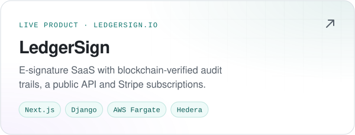
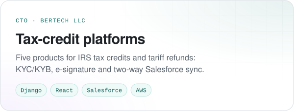
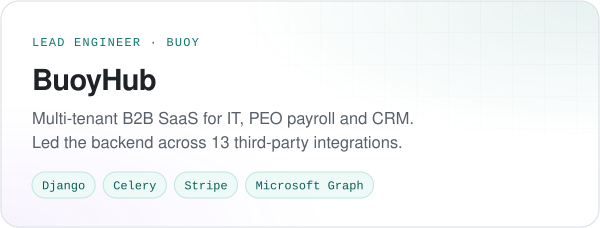
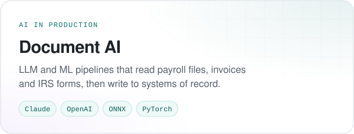
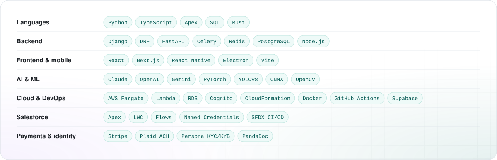

<picture>
  <source media="(prefers-color-scheme: dark)" srcset="./assets/hero-dark.svg">
  
</picture>

 

I'm a founder and CTO who still writes most of the code. For the last few years I've built software for regulated work: IRS tax-credit enrollment, KYC/KYB, legally binding e-signatures and ACH payouts. I also put LLMs into the document workflows behind them. Most of that code lives in private client repos, so this page is the short version.

### Selected work

  <a href="https://ledgersign.io"><picture>
    <source media="(prefers-color-scheme: dark)" srcset="./assets/card-ledgersign-dark.svg">
    
  </picture></a>
  <picture>
    <source media="(prefers-color-scheme: dark)" srcset="./assets/card-taxcredit-dark.svg">
    
  </picture>

  <picture>
    <source media="(prefers-color-scheme: dark)" srcset="./assets/card-buoyhub-dark.svg">
    
  </picture>
  <picture>
    <source media="(prefers-color-scheme: dark)" srcset="./assets/card-docai-dark.svg">
    
  </picture>

### Toolbox

<picture>
  <source media="(prefers-color-scheme: dark)" srcset="./assets/toolbox-dark.svg">
  
</picture>

### Now

- Leading engineering at **BerTech LLC** on US tax-credit, tariff-refund and payout platforms
- Running **1PercentLabs**, a product studio for AI, SaaS and mobile builds
- Shipping **LedgerSign**, e-signature with blockchain-verified audit trails

 

  <a href="https://www.linkedin.com/in/abdul-wahab-rind"><picture>
    <source media="(prefers-color-scheme: dark)" srcset="./assets/btn-linkedin-dark.svg">
    
  </picture></a>
  <a href="https://1percentlabs.com"><picture>
    <source media="(prefers-color-scheme: dark)" srcset="./assets/btn-1percentlabs-dark.svg">
    
  </picture></a>
  <a href="https://ledgersign.io"><picture>
    <source media="(prefers-color-scheme: dark)" srcset="./assets/btn-ledgersign-dark.svg">
    
  </picture></a>

