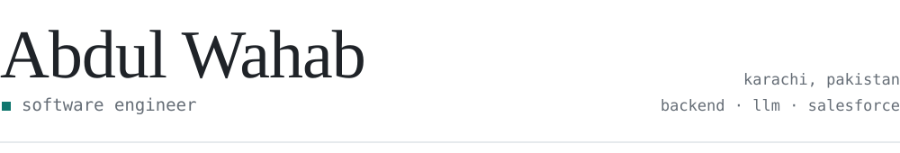
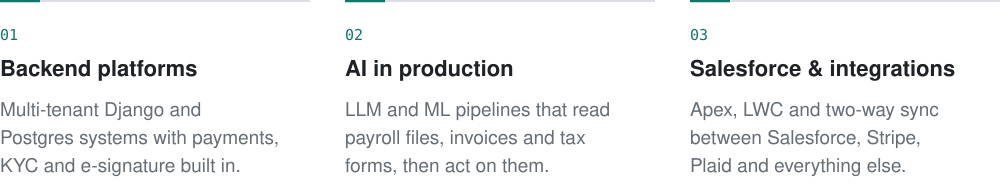

<picture>
  <source media="(prefers-color-scheme: dark)" srcset="./assets/header-dark.svg">
  
</picture>

I build backend systems for tax, compliance and payments work, and the LLM pipelines that read the documents those systems run on. I lead a small team and still write a lot of the code.

### What I'm good at

<picture>
  <source media="(prefers-color-scheme: dark)" srcset="./assets/expertise-dark.svg">
  
</picture>

### Things I've built

- Five tax-credit and refund platforms on one shared architecture: enrollment, identity checks, e-signature and Salesforce sync
- An ACH payout system on Plaid that settles ~20K transactions per pay cycle
- A move off a vendor's serverless stack to Django and Celery that cut cloud costs by ~$650–700 a month
- A multi-tenant B2B SaaS with 13 third-party integrations and 1,100+ tests
- Document pipelines where Claude and custom ONNX models read payroll files and IRS forms
- An e-signature product with blockchain-verified audit trails

### Stack

  <picture>
    <source media="(prefers-color-scheme: dark)" srcset="https://skillicons.dev/icons?i=py%2Cts%2Cdjango%2Cfastapi%2Creact%2Cnextjs%2Cpostgres%2Credis%2Cdocker%2Caws%2Cgithubactions%2Cpytorch%2Csupabase%2Cfirebase&theme=dark&perline=14">
    
  </picture>

Also Salesforce (Apex, LWC, Flows), Celery, the Claude and OpenAI APIs, Stripe and Plaid.

 

Most of my work lives in private repos. The best way to reach me is [LinkedIn](https://www.linkedin.com/in/abdul-wahab-rind).
